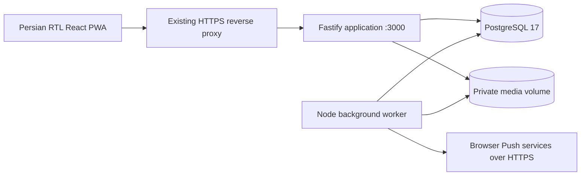

# Architecture

## Runtime boundaries

This is a modular monolith, with one shared Node 24 artifact and a separate process for durable work. `server/index.ts` starts HTTP; `server/worker.ts` executes jobs; `web/src` contains the React interface. TypeScript compiles to `dist/server` and `dist/scripts`; Vite builds the client. No Redis, object-store service, Instagram account connection, or paid external service is required. Web Push is optional and depends on browser infrastructure.

`server/core/db.ts` owns pooled access and transactions. All statements in a transaction use the same checked-out client. `security.ts` owns sessions, authorization helpers, notifications and auditing. Domain routes live under `server/modules`: content, scheduling, stories, media, tasks, analytics, reports, and notifications. [API_CONTRACT.md](API_CONTRACT.md) describes cross-module interfaces; actual validation remains authoritative in route code.

## Data and workflow boundaries

Content identity remains stable while output edits create new revisions. Approval is tied to a revision. Schedule-only operations mutate slot records separately; a page lock, version and preview hash protect queue changes. Published content retains its revision and publication history. Claims and publication are transactional; repeat publication must preserve the original timestamp and deduplicated analytics jobs.

Story package approval covers the ordered unpublished sequence. Published items remain locked through later changes. Analytics snapshots are observations at actual times, independent from publication and from reminder timing. Weekly reports represent a local Saturday-to-Saturday interval. Missing observations remain missing, while zero is a measured value.

Media originals remain immutable private files. Authenticated handlers enforce purpose/page/record access rather than exposing the filesystem as a public static directory. Thumbnail generation is separate from originals. No arbitrary URL fetch is needed for music links. [BACKUP_RESTORE.md](BACKUP_RESTORE.md) treats database rows and referenced files as one consistency unit.

## Worker and failures

`jobs` is the durable queue. Workers claim due jobs under database row locks with `SKIP LOCKED`; attempts and locks support retry and recovery. Stable deduplication keys prevent duplicate publication reminders. Work-item completion stops outstanding reminders even when another active member submits the required data. In-app notifications remain usable without Push permission.

Worker liveness is measured through `worker_heartbeats`; Compose checks for a heartbeat within two minutes. API liveness uses `/api/health`. HTTP and worker shutdown must close active resources within the Compose grace period. Monitoring must alert on unhealthy containers, persistently failed jobs, stale heartbeats and storage exhaustion.

## Environment and security boundaries

Local and production build the same `production` Docker target. The runtime is non-root and excludes development dependencies. Production has a read-only root filesystem and writable media and temporary storage. PostgreSQL is on an internal network. Only the app joins the existing proxy network. The worker also joins an isolated egress bridge because Push subscriptions require outbound HTTPS; it has no listener or published host port. `expose` is documentation, not a firewall.

All active members can view both pages; edit, suggest and report visibility are independently enforced per page on the server. Owner-only actions remain owner-only even when a member knows a record UUID. Authentication uses random opaque sessions with database token hashes, scrypt password hashes, HttpOnly cookies and origin checks. Logs must not contain credentials or raw private payloads.

Business dates use `Asia/Tehran`, date-only SQL columns and Jalali presentation. Actual instants use `timestamptz`/UTC. Browser locale does not define reporting periods or reminder boundaries.

## Maps and verification

Graphify outputs live in [`../graphify-out/`](../graphify-out/) and complement this document. Their actual generation status is in [PROGRESS.md](PROGRESS.md). See [ACCEPTANCE_CRITERIA.md](ACCEPTANCE_CRITERIA.md) for implementation and verification evidence; architecture intent is not a test result.
